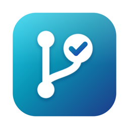

# MyGitApp

Client GitHub natif macOS (SwiftUI), rapide, centré sur les repos que tu choisis et sur les reviews de PR
(y compris celles de Codex).

- **Sidebar curée** : seuls les repos épinglés apparaissent : repos GitHub (perso + orgs) ou dossiers locaux
  (un clone se résout tout seul vers son repo GitHub, worktrees compris). Réordonnables par drag & drop.
- **Vue repo** : PRs ouvertes, CI des 7 derniers commits, dernière release, stars sur 30 jours, commits récents,
  langages, contributeurs, raccourcis vers le clone local (Finder, Terminal, éditeur).
- **PRs** :
  - *Conversation* : chaque review affiche les threads qu'elle a ouverts, avec l'extrait de code ciblé et toutes
    les réponses ; les pushes et commentaires sont intercalés à leur date. Les threads résolus peuvent être masqués.
  - *Threads* : tous les threads groupés par fichier, comme une to-do pour traiter une review.
  - *Files* : le diff, avec les threads insérés à leur ligne.
  - *Checks* : statut CI du dernier commit.
  - Actions : répondre, résoudre / rouvrir, commenter, approuver, merger (squash / merge / rebase).
  - *Reviewers* : sous l'en-tête, les reviews en attente (retirables) et « Demander une review », une liste
    filtrable au clavier des personnes ayant accès au repo (suggestions de GitHub en tête) et des équipes de l'org.
  - **« Pour l'agent »** copie un thread (ou tous les non résolus) en markdown prêt à coller dans Codex / Claude.
- **Nouvelle PR** (⌘N, bouton « Nouvelle PR » d'un repo, ou palette ⌘K) : la branche est présélectionnée (celle du
  clone local, sinon ta dernière branche sans PR), le titre et la description sont préremplis depuis les commits ou le
  template de PR du repo, avec le nombre de commits et le diff à proposer. Brouillon en une case, création en ⌘↩.
  Si la branche locale n'est pas encore sur GitHub, un bouton la pousse. Les branches poussées récemment sans PR
  s'affichent en haut du repo avec « Créer une PR ».
- **Home / Pull requests / Review requests / Inbox**, filtrés par défaut sur les repos épinglés.
- **Branches locales** (⇧⌘B, sidebar, ou bouton « Branches locales » d'un repo ; repris de
  [GitGardener](https://github.com/geoffroyriou-weqeep/gitgardener)) : pour chaque repo épinglé avec un clone local,
  ses branches et worktrees, avec leur emplacement (local uniquement, suivie, supprimée sur origin, uniquement sur
  origin), la PR associée et un verdict : *Sûre* (mergée, squash et rebase compris), *À vérifier* (pas mergée mais
  tout est sur origin), *Risquée* (commits nulle part ailleurs, ou worktree modifié), *Bloquée* (branche de base,
  branche extraite dans le dossier principal, workspace Conductor actif, worktree d'un thread T3 Code actif). Les
  branches de base sont auto-détectées et modifiables par repo.
  - *T3 Code* : les threads sont lus (lecture seule) dans `~/.t3/userdata/statev2.sqlite`. Le worktree d'un thread
    actif est bloqué, avec le titre du thread ; celui d'un thread archivé est signalé mais suit son verdict normal.
    Si la base est illisible, tous les worktrees de `~/.t3/worktrees` sont bloqués par prudence.
  - *Taille* : sélectionne des branches (ou « Sélectionner les sûres »), puis confirme dans une feuille qui refait
    un `fetch` et recalcule les verdicts avant de lister ce qui sera détruit (dossiers de worktree, fichiers non
    commités ou ignorés). Supprimer sur origin est une option explicite ; le risqué demande de taper « supprimer ».
  - *Journal* : les branches supprimées sont gardées 30 jours et restaurables tant que leurs commits existent.
  - La logique (lecture, verdicts, taille, journal) vit dans la cible `GitGardenerCore`, sans UI, testée à part.

## Installation

Prérequis : macOS 15, Xcode 16 et la CLI [`gh`](https://cli.github.com) connectée (`gh auth login`).
L'app réutilise le token de `gh` ; sinon elle propose de coller un token personnel (scopes `repo`, `read:org`,
`notifications`), stocké dans le Trousseau.

```sh
make run       # build release + lance build/MyGitApp.app
make install   # copie l'app dans /Applications
make test      # tests unitaires
make debug     # build debug, plus rapide à itérer
```

Le projet est un Swift Package : `open Package.swift` l'ouvre dans Xcode.

## Releases

Chaque push sur `main` (hors changements de `.md`) lance `.github/workflows/release.yml` : tests, build,
puis une release GitHub `vX.Y.N` avec `MyGitApp-X.Y.N.zip` (`X.Y` vient du fichier `VERSION`, `N` est le
numéro du run).

Le job tourne sur le runner self-hosted du Mac mini (`~/ci/mygitapp/runner`, service launchd
`actions.runner.slaynn-mygitapp.mac-mini-m1-mygitapp`) : aucune minute GitHub consommée. Si le Mac mini est
éteint, le job attend dans la file jusqu'à son retour.

L'app installée dans `/Applications` se met à jour seule : au lancement puis toutes les 4 h, elle vérifie la
dernière release, la télécharge et la vérifie en arrière-plan, puis propose « Redémarrer pour passer en X.Y.N »
en bas de la sidebar (sinon la mise à jour s'applique en quittant l'app). Menu MyGitApp → « Rechercher des mises
à jour… » pour forcer la vérification. Téléchargée par l'app elle-même, la mise à jour n'est pas mise en
quarantaine : pas d'alerte Gatekeeper.

```sh
make update    # installe la dernière release dans /Applications (premier install, ou sans attendre)
```

L'app n'est pas signée avec un certificat Apple : `make update` télécharge via `gh`, ce qui évite la
quarantaine de Gatekeeper. Si tu télécharges le zip depuis le navigateur, ouvre l'app avec clic droit → Ouvrir
(ou `xattr -dr com.apple.quarantine /Applications/MyGitApp.app`).

## Raccourcis

| | |
|---|---|
| `⌘K` | Aller à un repo / une PR |
| `⌘1` … `⌘9` | Repos épinglés |
| `⌘0` / `⇧⌘I` | Home / Inbox |
| `⇧⌘P` | Gérer les repos de la sidebar |
| `⌘R` | Rafraîchir (sinon automatique toutes les 60 s) |
| `⌘[` | Retour |
| `⌘↩` | Envoyer un commentaire / une réponse |

## Architecture

```
Sources/MyGitApp/
  App/      point d'entrée, AppState (navigation, listes globales), thème
  GitHub/   client GraphQL + REST, requêtes, modèles Codable, auth (gh + Trousseau)
  Store/    repos épinglés, cache disque (affichage instantané puis rafraîchissement)
  Local/    lecture des clones git locaux (remote GitHub, branche, scan d'un dossier)
  Review/   logique pure : timeline des reviews, parsing des diffs, nettoyage du markdown des bots
  Views/    SwiftUI
```

Les données (repos épinglés, cache) sont dans `~/Library/Application Support/MyGitApp/`.

Pour vérifier un écran sans cliquer (dev), l'app peut s'ouvrir sur une vue et s'auto-capturer :

```sh
MYGITAPP_OPEN='owner/repo#12' MYGITAPP_TAB=threads MYGITAPP_SNAPSHOT=/tmp/shot.png \
  build/MyGitApp.app/Contents/MacOS/MyGitApp
```

Créé dans [T3 Code](https://t3.codes).
